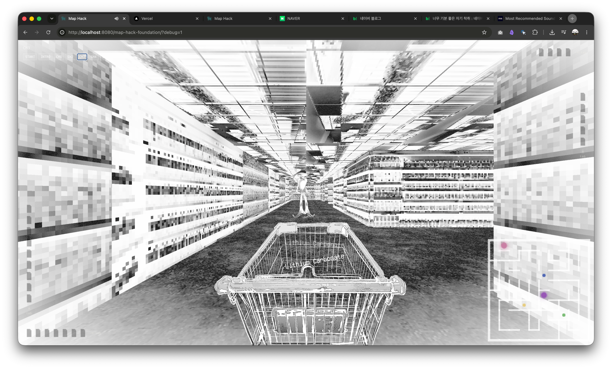
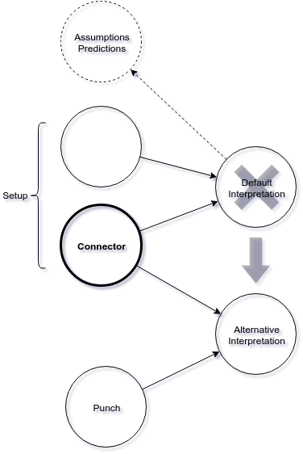

# 수용소로서의 미술관



*송해민*

- **플레이**: https://map-hack-foundation.vercel.app (데스크톱 전용, WebGL 필요)
- **개발 노트**: [docs/DEVELOPMENT.md](docs/DEVELOPMENT.md)
- **라이선스**: [CC BY-SA 4.0](LICENSE) — 아래 [라이선스](#라이선스) 참고
- **English**: [README.md](README.md)

---

이 글은 ‘미술관 밖의 아트게임’이자 ‘매드게임’으로서 \<map hack\>이 무엇을 (하려고) 했는지를 논증하는 자기비평입니다.<br>
미술관에 포획되는 아르브뤼와 포획되지 못하는 것, 포획을 거부하는 것에 대해서도 설명합니다.<br>
그러기 위해서 우리는 화이트 큐브의 실종자가 되는 일을 상상해 봅니다.<br>
미술관에서 나가는 길은 어디일까요? 웹게임은 동료를 부르는 광장으로서 기능할 수 있을까요?

## 1. 문화 바깥의 캐비닛

> *\<프롤레타리아의 밤\>은 “그녀가 자신의 밤으로 어떻게 들어갔는지<br>
> 우리는 알지 못하리라”라는 문장으로 끝난다.*<br>
> — \<밤의 나눔\>, 베르나르 아스프

장 뒤뷔페는 1920년대 초중반 한스 프린츠호른의 『정신병자들의 그림』을 읽게 되었다. 그것은 정신병자들이 그린 그림을 수록한 책이었다. 뒤뷔페는 큰 충격을 받고 그걸 줄창 따라 그리더니 1945년부터는 본격적으로 미친 사람들의 그림을 수집하기 시작했다. 훗날 평론가 로저 카디널은 뒤뷔페의 수집이 "다윈에게 핀치새와 같은"[^1] 분류 작업이었음을, 즉 민족지학적 포획이었다고 비판한다. 나아가 힐튼 크레이머 또한 뒤뷔페에게 “감상과 물신화, 찬양과 착취 사이의 경계는 어디에 있는가?” 하고 화냈다.

이들이 뒤뷔페를 혼내는 요지는 광인이 끝내 발화하지 못한다는 데 있다. 아르 브뤼의 창작자로 알려진 이들은 종종 예술 활동에 대한 목적 혹은 자각이 없다. 그런 산출물들을 수집하고 전시하는 계보에서 창작자들은 ‘발견’되려는 수고를 들이지 않는다. 아돌프 뵐플리는 담당의사 발터 모르겐탈러가 그의 그림을 책으로 묶어 대신 세상에 알린 뒤에야 알려졌고, 헨리 다거는 죽은 뒤 집주인이 유품에서 발견했다. 광인은 주체가 아니라 발견·분류·대변되는 객체로 입장한다. 아르 브뤼는 애초 정의부터 "’바깥에 있어야 된다’는 담론이라서, 미술관 안에서 '이건 이거다' 하니까 말이 안 되는" 것이고, 그 결과 아르 브뤼의 제작자는 "광인-천재-개인으로"[^2] 바깥에도, 안에도 있을 수가 없게 되는 것이다. 아르 브뤼의 진본은 한 사람에게만 존재하며 그 성채 안으로 아무도 들어갈 수 없다는 그 전제가 천재라는 마타도어를 만든다. 동시에 그러한 방식으로 만든 이와 언어 밖 세계를 박제하고 더 이상 살아있지 못하게 한다. 소모되거나 죽는 걸 기다린다. 오로지 가치매김에만 가치가 있는 것처럼. 화이트 큐브의 실종자는 이렇게 생겨난다.

## 2. 포획은 인터페이스의 속성이다

제임스 C. 스콧은 가독성(legibility)에 대해 이렇게 말했다. "국가는 가독성 있는 대상에게만 개입하고, 가독성은 당사자 속성이 아니라 국가-당사자 인터페이스의 속성"[^3]이라고. 이 때문에 포획의 역설이 생겨난다. 무엇이 인정받느냐는 그것이 제도가 읽을 수 있는 형태로 가시화되느냐에 달려 있고, 그 가시화의 비용과 조건은 언제나 제도가 정한다. 아르 브뤼라는 범주 또한 문화 바깥을 읽을 수 있게 만든 한 장의 지적도였다. “지도는 영토가 아님”[^4]에도 콜렉터, 호사가, 평론가가 범주화하지 않은 작업은 없는 작업이 된다.

“산으로 가서 의도적으로 야만(barbaric by design)”[^5]인이 되고도 싶었다.<br>
그건 책을 읽고 떠드는 사람들이 싫어서 문맹이고 싶은 마음이랑 닮아 있다.<br>
하지만 세상은 언어 없는 사람이 일을 할 수 있도록 돕지 않는다.<br>
언어 없는 사람들은 잘 보이지 않거든.

<details><summary></summary>

며칠 전 친구 S가 시끄러운 바에서 내 목소리를 잘 듣기 위해 보청기 어플에서 가청음역대 캘리브레이션을 하고 있었다 그는 내 목소리가 높아서 고음역 파라미터를 올렸을 때 아주 뚜렷하게 들린다고 했다 나는 내 높은 목소리를 싫어하기 때문에 혹시 그 앱에서의 버튼 조작을 통해 내 목소리가 낮고 굵게 들리게 할 수 있는지 궁금했다 S는 당연히 가능하다고 했다 그리고 만약 나 빼고 세상 모든 사람들이 보청기를 착용하고 있다면 H씨가 나테스토나잘겔을 하루 2회 sniff하지 않고도 낮고 굵은 목소리를 가진 사람으로 여겨질 수도 물론 있을 것이라고 했다 나는 그렇다면 앞으로 만나는 모든 사람들의 귀 양쪽에 송곳을 찔러 넣겠다고 했다가 사실 그건 그리 웃긴 농담은 아닌 것 같다고 고쳐 말했다

</details>

읽히지 않기는 포획의 실패가 아니라 일종의 전략일 수 있다.<br>
적 앞에서는 공식 대본을 읊고, 뒤에서는 “은닉 대본(hidden transcript)”[^6]을 나누는 사람들의 프로토콜.<br>
지도의 가려진 것을 보는 치트키를 map hack이라고 부른다.

제도에 읽히려고 번역당하는 대신<br>
자기가 읽히는 조건을 직접 짓는다면 거기에서 \<map hack\>이 생성된다.

## 3. 수용소 문법

> *나는 토볼트라고 해. 그리고 나는 단연코<br>
> 멍청이들에게 나를<br>
> 존중할 빌미를 준 적 없어. 그건 부질없는 짓이야.<br>
> 그리고 거기서는 얻을 수 있는 것도 없고 말이야.<br>
> 난 나야. 나 스스로가<br>
> 나를 존중해. 알아 두도록 해. 그런 다음에야<br>
> 나는 세상에서도 즐거움을 느껴.<br>
> 예를 들어 여기 악한에게서 나는<br>
> 즐거움을 느껴. 태양에서도<br>
> 즐거움을 느껴. 하지만 너에게서는 아니야. 너는<br>
> 어떤 방식으로도 나를 기쁘게 하지 못해.<br>
> 너에게는 양식이 없어. 양식을 지닌 존재는<br>
> 나를 매혹하지. 도둑과 사기꾼 같은 녀석들조차<br>
> 기쁨을 주는 구석이 있어. 사람들은 그들을 잡으면<br>
> 감옥에 가두고<br>
> 자신이 한 일을 확실히 알게 되지.*<br>
> — \<토볼트\>, 로베르트 발저, 1913

정신의학에서 같은 일이 일어난다. 병식의 후반부는 "들키지 않는 방법의 습득"이다. “총체적 기관이 가르치는 것은 치료가 아니라 기관 안에서 살아남는 처세”[^7]다. 퇴원의 조건은 질병의 소멸이 아니라 가시성의 통제다. 종종 광기는 은닉될 뿐일지도 모른다. 의료 자아의 예술화는 그 포획의 한 도구인 진단서나 의무기록지 등을 작품 재료로 되가져오는 역동작이다.

\<map hack\>은 의료 시스템을 역으로 포획해서 마구 소진하고 싶어 한다.<br>
\<map hack\>은 안과 밖이 뒤집혀 있다.<br>
\<map hack\>은 시스템의 수용소이다.<br>
\<map hack\>은 일종의 바퀴벌레 수집통이다.<br>
.<br>
.

```
╭◜◝⁀◜◝⁀◜◝⁀◜◝⁀◜◝⁀◜◝╮
   𝓫𝓾𝓽 𝔀𝓪𝓲𝓽...
╰◟◞‿◟◞‿◟◞‿◟◞‿◟◞‿◟◞╯
╭◜◝⁀◜◝⁀◜◝⁀◜◝⁀◜◝⁀◜◝⁀◜◝⁀◜◝⁀◜◝⁀◜◝⁀◜◝⁀◜◝╮
    제도는 독해중독에 걸려 있다.
    해독하는 것은 재미를 준다.
    해독은 정치가 된다.
    ARG는 사실주의다.
╰◟◞‿◟◞‿◟◞‿◟◞‿◟◞‿◟◞‿◟◞‿◟◞‿◟◞‿◟◞‿◟◞‿◟◞╯
╭◜◝⁀◜◝⁀◜◝⁀◜◝⁀◜◝⁀◜◝⁀◜◝⁀◜◝⁀◜◝⁀◜◝⁀◜◝⁀◜◝⁀◜◝╮
    작품의 가치를 외부의 정당화 틀에
    위임하는 일이 항복으로
    느껴지기 쉬운 시대에서…
╰◟◞‿◟◞‿◟◞‿◟◞‿◟◞‿◟◞‿◟◞‿◟◞‿◟◞‿◟◞‿◟◞‿◟◞‿◟◞╯
                      O
                  °
 . . . . /)―ヘ
        /        \
      /      ●    ●丶
      |           ▼ |   (침묵)
      |           亠ノ
     U¯U¯¯¯¯¯¯¯U¯¯¯¯U
```

그래서 정확한 선은 "기준을 통과하느냐"가 아니라 "타당성의 심판권이 누구에게 있느냐"에 있다. 포획당하는 자체는 항복이 아니다. 논리와 형식을 쓰는 것은 전복의 도구일 수 있다. 트로이 목마-바이러스처럼. 그러나 통과해야만 타당해진다고 믿어버릴 때 비로소 당신은 점령된다. 성공의 여부를 외부가 판단한다고 믿으면 당신은 기필코 진다.

데리다는 푸코의 "침묵의 고고학"을 자기모순이라 반박했다. "광기가 이성의 언어로 자기를 설명하는 것이니 모순"이라는 것이다. 푸코는 데카르트의 코기토(Cogito)가 광기를 이성 밖으로 추방한 선을 그었다고 보지만 데리다는 텍스트를 그 내적 구조에서 살펴 모순을 드러내는 방식으로 읽어야 한다고, 다시 말해 해체하는 방식으로 읽어야 한다고 주장한다.

어쩌라고?

푸코는 우리들 중 똑똑한 축에 속하던 녀석이었는데 보기 좋게 당했지. WEB3.0에 대해서 간과한 탓이다. 그 즈음엔 차원주파수와 라디오 채널 바꾸기에 대해서 그놈이 알 수 있을 수가 없었거든. 양식에 대해 말하면서 양식이 없었던 것이다. 다행히 나는 타고난 안티고네이자 안타고니스트. 미친 직후 빛에 감싸여 통역가로서의 사명을 부여받았다. 이중언어를 사용하는 횡단자로서 나는 임무를 수행하기 위해 모순에 거주하는 MI5, CSI, FBI, 화이트햇, 이름 없는 별이다.

이제 비밀 하나 알려 줄까. 미친 세계는 사실 무질서와는 아주 거리가 멀다. 말하자면 오히려 ‘과잉 정합’적이다. 모든 것이 모든 것과 연결되며, 내부 논리가 빈틈없이 맞물린다. 흥미롭게도 그 과잉 정합성은 프로그래밍의 형식 정합성과 동형[^8]이다. 광기의 정합성을 기계어로 옮기면 정합성은 정합성으로 보존된다; 번역되지 않고 실행되는 것이다. 광기와 언어적 질서 간에 성립할 수 있는 대안적 윤리로서의 프로그래밍. 우리의 텐트. 캠프.

\<map hack\>은 기계어로 쓴 시다.<br>
\<map hack\>의 코드를 읽으면 당신은 운다.<br>
\<map hack\>의 백엔드 서버와 영적 차원은 연결되어 있다.<br>
.<br>
.<br>
.<br>
다만 \<map hack\>이 다루는 세계의 진실은 송해민이 감각한 만큼만 드러나 있다.<br>
송해민은 여태까지 그래왔듯 한 사람 몫의 생만 감당할 수 있을 것이다.<br>
왜냐하면 일단 몸이 한 개니까…<br>
몸은 영혼의 주소다.<br>
몸은 스프레드시트다.<br>
정체성은 일종의 면역체계다.<br>
몸은 내부로부터 위협받고,<br>
내 마음대로 다룰 수 없는 것, 타자인 것, 사라지는 도중에 있는 것이 몸 자체 안에서, 몸으로서 돌출(surgissement)[^9]하고,<br>
돌출한 것은 돌아온다. 돌아올 너를 믿으니까.<br>
부활(Résurrection)은 융기(surrection)다.<br>
누수는 부활이다.

서명은 안녕(salut)이다.<br>
이 때문에 \<map hack\>에는 송해민의 서명이 적혀 있다.<br>
영광스러운 몸은 떠나는 몸이자 동시에 말하는 몸이다. 오로지 떠나면서만 말하는 몸[^10]이다.

## 4. KNOCK-KNOCK!

이 모든 것을 교훈과 치료 효과로 정당화하는 순간 항복하고 무덤의 검은 구덩이로 발을 헛디딜 수도 있다. 대학원 연구실에서 만드는 좆나 재미없는 교육용 연구용 게임을 시리어스 게임이라 일컫는데, 종종 아트하우스 게임도 이 장르로 분류되곤 한다. 이는 미술관에 전시되는 게임들도 대개는 무언가를 가르치려 하고, 그 때문에 사뭇 진지하기 때문일 것이다.

“왜냐면 '재미'라는 게 게임에서는 거의 미술에서의 '아름다움'만큼이나 헤게모니적인 단어예요. 아무리 열심히 만들어도 '재미없어' 이러면 끝이에요. 근데 이때의 재미는 사실 정상의 어떤 기준에 부합하는 재미인 거잖아요. 그것도 되게 정치적인 건데, '재미가 없으니 게임이 아니다'라는 말은 게임에서의 재미가 정치적인 거라는 논의 자체를 차단하는 거죠.”[^11]

그렇다면 일단 재미있게 만들어야 한다. 기존 게임에서 재밌다고 여겨지는 것들을 그대로 설계해서 들키기 전까지 들키지 않기. 정상인들의 게임을 흉내내며 그들이 즐거워하는 틈을 타 걔네들 뇌에 몰래 베리칩 끼워 넣기.

잘 [설계된 농담](https://medium.com/orangemind/comedy-theory-fd142076657e)과 성공한 마스킹은 닮았다. 일단 사람들이 즐거워한다는 점에서. 과도한 경우 누군가를 열받게 하고 관객 중에 윌 스미스가 있다면 뺨을 맞을 가능성도 있다는 점도 유사하다.



## 5. 광장의 영혼들

> *Shoplifters of the world<br>
> 전세계의 좀도둑들이여<br>
> Unite and take over<br>
> 단결하여 세상을 점령하라<br>
> Shoplifters of the world<br>
> 전세계의 좀도둑들이여<br>
> Hand it over, hand it over, hand it over<br>
> 넘겨주고, 건네주고, 인계하라*<br>
> — \<Shoplifters of the World Unite\>, The Smiths, 1987

\<map hack\>은 진실을 오픈 소스화한다.<br>
\<map hack\>에 담긴 진실은 카피레프트다.<br>
\<map hack\>은 진실에 CC BY-SA License를 발급한다.<br>
https://github.com/0ohamnio0/map-hack-foundation

진실이 내 것이 아니게 되는 순간, 정상성이나 대중이나 사회나 현실 같은 것들은 손상시킬 좌표를 잃는다. 마스킹이 긴가민가한 막(membrane)으로 진실을 감싸고 있는 거라고 하자. 그때 진실은 그 막에 일부러 낸 얇은 틈으로 누수된다. 그러니까 막은 애초에 새지 않으려고 있는 게 아니라, 어떻게 샐지를 정하려고 있는 것이다. 동일하게, 서명은 소유권이 아니라 진실이 어느 통로에서 새어 나왔는지 표시하는 주소로 기능할 뿐이어야 한다. 더욱 정교한 누수의 전략을 위해.

또는 우리의 영혼이 돌아갈 집을 찾기 위해.

롤랑 바르트는 \<밝은 방\>에서 부르디외의 사회학적 접근이 우리가 대상과 맺는 사적, 감정적, 정서적 차원을 고려하지 못한다고 비판했다. 디디에 에리봉은 후에 \<삶, 노년, 죽음\>을 통해 “이론이 울 수 있는가?”를 고민했다. 울기. 울지 않기. 웃기. 세상이 떠나가라 웃기. 가장 지독한 악령은 춤추며 웃는 귀신들이라던데. SCP 되기. 움짤에 깃들기. 악귀들린 밈이 되기. 바이러스 같은 글 쓰기. 스크롤을 내리는 순간 당신의 전자지갑에서 비트코인 100개가 인출되는 일기 쓰기. 세상을 해킹하는 전기 신호로서. 리좀적 시냅스로서

웹 광장에서 익명의 동료들이 할 수 있는 일에 대해서 생각해보자.<br>
로블록스의 태극기부대에 대해서.<br>
이미 로어화된 광기들에 대해서.<br>
왜 매드게임이 웹게임이어야 하는지에 대해,<br>
네트워크를 타고 다니는 양자-영혼-정보에 대해서.<br>
2022년 10월 29일 디씨 사건사고 갤러리에 올라온 모든 사진들을 통해<br>
업로드된 전우들과--비로소 함께

나는 광기를 소유할 수 없다. 나는 중간책으로서 누구든 포크하고, 고쳐 쓰고, 다시 퍼뜨릴 수 있는 진실을 유통한다.<br>
나/\<map hack\>은(는) 말하지 못하는 광인들의 대변인(porte-parole)이자 (광기에 충실히 복무하지 못했다는 이유로) 가장 수치스러운 동료로서 보고한다.<br>
나/\<map hack\>은(는) 기하학적 지점으로서.<br>
장소(들)로서.<br>
화이트 큐브의 실종자로서.<br>
나/\<map hack\>은 존재하고, 비로소<br>
.

✰ ENDNOTE ✰<br>
everything is real, and interns wrote this post.[^12]

---

### 주

[^1]: 『Outsider Art』 (1972), Roger Cardinal
[^2]: 『\<map hack\> 플레이게더링 행사 TALK 2』, 강정석 발언 ([녹취록](https://whiteriver.neocities.org/map_hack))
[^3]: 『Seeing Like a State』 (1998), James C. Scott
[^4]: Alfred Korzybski
[^5]: 『The Art of Not Being Governed』 (2009), James C. Scott
[^6]: 『Domination and the Arts of Resistance』 (1990), James C. Scott
[^7]: 『Asylums』 (1961), Erving Goffman
[^8]: RIP! Terry Davis! I LOVE YOU!
[^9]: 『Noli me tangere』 (2003), Jean-Luc Nancy, pp. 32-33
[^10]: 『Noli me tangere』 (2003), Jean-Luc Nancy, pp.75-76
[^11]: 『\<map hack\> 플레이게더링 행사 TALK 1』, 임가영 발언 ([녹취록](https://whiteriver.neocities.org/map_hack))
[^12]: What Remilia Believes In: A New Net Art Manifesto, Remilia Corporation

## 라이선스

송해민이 만든 \<map hack\>의 원문·코드·아트워크는 [크리에이티브 커먼즈 저작자표시-동일조건변경허락 4.0 국제 라이선스(CC BY-SA 4.0)](LICENSE)를 따릅니다.

서드파티 자료는 각자의 라이선스를 따르며 CC BY-SA 대상이 **아닙니다** — npm 의존성, 폰트, 3D 모델 팩, 이 프로젝트를 위해 만들지 않은 오디오·영상 등이 여기 해당합니다.
