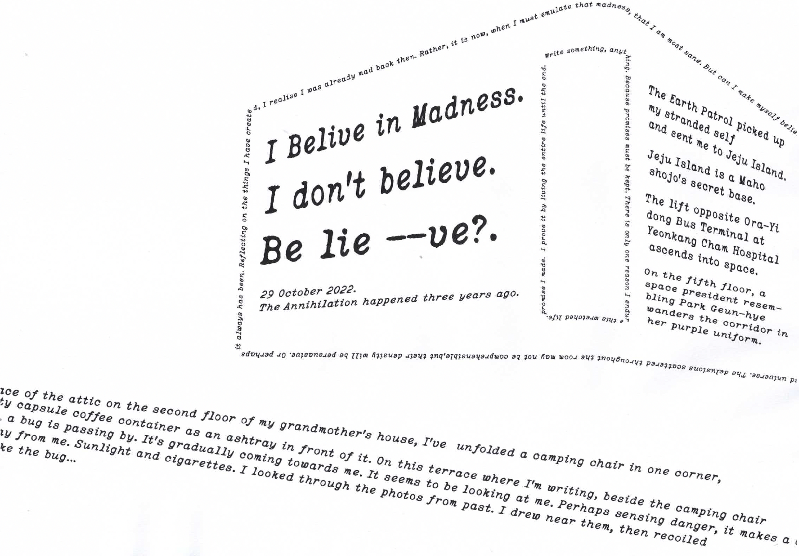

# Map Hack



**조울증 경험을 미로 탐색으로 옮긴 웹 인터랙티브 게임 (20분).**
침대에서 시작해 골목·마트·병원을 지나 블로그에 도착하는 5개 챕터를 통과하며, 쪽지와 시 조각으로 흩어진 텍스트를 줍는다. 데스크톱 전용(WebGL 필수).

- **플레이**: https://map-hack-foundation.vercel.app
- **스택**: Vite 6 + React 19 + TypeScript · React Three Fiber + @react-three/rapier + ecctrl · Zustand · CH.4 타이포그래피는 [@chenglou/pretext](https://github.com/chenglou/pretext) · 방명록은 Vercel Serverless + KV

## 챕터 구성

```
START → INTRO → CH.1 → CH.2 → CH.3 → CH.4 → CH.5 → END(크레딧)
```

| 챕터 | 이름 | 내용 |
|------|------|------|
| INTRO | ··· | 인트로 영상 — baked 오디오가 CH.1 BGM으로 이어짐 |
| CH.1 | 침대에서 | 침실 연출 씬 — 카메라가 문을 향해 나아가는 시네마틱 (LightShadowRainbow) |
| CH.2 | 골목 | 3인칭(ecctrl) 골목 미로 — 표지판, 떨어진 쪽지, 우체통 편지, 공항 환각, NPC, 그래피티 |
| CH.3 | 마트에서 | 약 카트 담기, 연두색 시 조각 수집, 엘리베이터, 고스트 라디오, 유령 조우 |
| CH.4 | 병원으로 | Pretext 타이포그래피 — 타이핑 → 글리치 → 잉크 번짐 (2D, 자동 진행) |
| CH.5 | 블로그 | 블로그 화면 + 방명록 작성 → 모니터 밖으로 빠지는 dolly-out 엔딩 크레딧 |

엔딩 크레딧에 한 번 도달하면(`gameCompleted`) 상단 챕터 네비게이션이 해금된다.

## 조작

| 키 | 동작 |
|----|------|
| **WASD** / 방향키 | 이동 |
| **Shift** | 달리기 |
| **Space** | 점프 |
| **E** | 상호작용 — 쪽지 읽기, 시 조각 줍기 등 |
| **Q** | 노트 본문 한/영 토글 (세션 전역 유지) |

## 개발

```bash
npm install
npm run dev        # Vite dev 서버
npm run build
npm test           # vitest
npm run prep-model # 외부 3D 모델 팩 → web-friendly GLB 변환 (scripts/prep-model.sh)
```

**URL 쿼리 (디버그)**

| 쿼리 | 동작 |
|------|------|
| `?debug=1` | 디버그 HUD + 챕터 이동 네비 |
| `?start=CH4` | 지정 챕터로 바로 진입 (디버그 모드와 무관) |
| `?sketch=1` | 스케치 이펙트 튜닝 패널 |

## 배포

- **Vercel** — SPA rewrite + `/api/guestbook` 서버리스 함수(Vercel KV, 최대 2000개 엔트리)가 함께 배포된다.
- `npm run deploy` — `gh-pages` 브랜치 스냅샷 배포(보조).

## 구조

| 경로 | 설명 |
|------|------|
| `src/Game.tsx` | 챕터 라우터 + 다음 챕터 영상 프리로더 + HUD |
| `src/store/useGameStore.ts` | 전역 상태 — chapter, cartItems, activeEffect, noteLanguage 등 |
| `src/scenes/` | 3D 챕터 (CH.1~3) + 골목 레이아웃·표지판 데이터 |
| `src/screens/` | 2D 챕터 (CH.4~5) |
| `src/components/game/` | PlayerController, NPC, NoteReader, Minimap, StartScreen 등 |
| `src/components/effects/` | 챕터 이펙트 — InkBleed, MedicationEffect, SketchEffect, StarNest 등 |
| `api/guestbook.ts` | 방명록 서버리스 함수 |
| `scripts/` | 에셋 전처리 — GLB 변환, 표지판 텍스트 풀 생성 등 |
| `public/assets/` | 3D 모델, 영상, 오디오, 폰트, 텍스처 |
